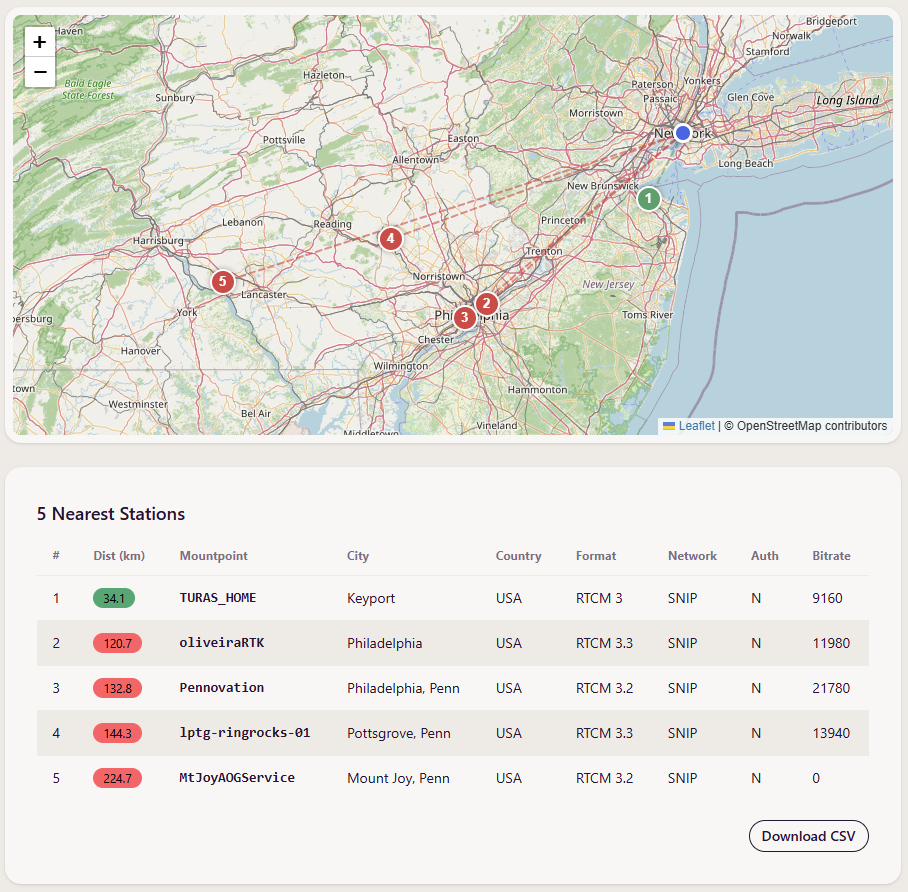

# RTK2GO Station Finder

A web app to find the 5 nearest RTK2GO NTRIP correction stations from any location. Search by address or coordinates, view results on an interactive map.

**See it in action**

Explore the five nearest correction stations to New York City: see their locations on the map, compare distances and station details, and export the results as CSV.

<table>
  <tr>
    <td>
      <a href="https://rtk2go.entr0-pi.com">
        
      </a>
    </td>
  </tr>
</table>

*Click the preview to try it live.*

🌐 **[See it live!](https://rtk2go.entr0-pi.com)** 🚀 (hosted on Vercel, deployed with the [Vercel guide](DEPLOYMENT.md#option-b-vercel-deployment))

**API key** — See [examples/API_KEY.md](examples/API_KEY.md)

## Features

- 🗺️ Interactive Leaflet map with station markers
- 🔍 Search by address or latitude/longitude with **country filtering**
- 📊 Results table with distance, format, network info
- 📥 **CSV export** button to download the 5 nearest stations
- 💾 SQLite database with refresh button
- 🌙 Light/Dark theme toggle
- 🔐 **API key login** with **JWT authentication** (15-min expiry, httpOnly cookies, XSS-proof)
- 🎨 **Color-coded distance badges** (green/yellow/red) in results table with configurable thresholds
- 🚦 **Dual-layer rate limiting** (browser + server) for Geoapify API protection
- ⚙️ **Environment-based configuration** for all API keys and service settings
- 🔄 **Timestamp-based rate limiting** with informative error messages showing time until next refresh

## Installation

**Prerequisites:** Python 3.11+

### 1. Install dependencies

```bash
pip install -r requirements.txt
```

### 2. Configure environment

Create a `.env` file in the project root:

```bash
# ============================================================================
# Authentication (required for login)
# ============================================================================
API_KEY=generate-a-random-secret-key-here
JWT_SECRET_KEY=generate-a-random-secret-key-here

# Generate strong secrets:
# python3 -c "import secrets; print(secrets.token_hex(32))"

# ============================================================================
# Admin dashboard (optional — dashboard returns 403 if unset)
# Access: GET /dashboard?key=<DASHBOARD_KEY>
# ============================================================================
DASHBOARD_KEY=generate-a-separate-dashboard-secret-here

# ============================================================================
# Geocoding API (Geoapify) - required for address searches
# ============================================================================
GEOAPIFY_API_KEY=your_api_key_here

# ============================================================================
# Rate limiting
# ============================================================================
GEOAPIFY_API_RATE_LIMIT=5/second
BROWSER_SEARCH_COOLDOWN_SECS=5
REFRESH_DB_RATE_LIMIT=1/day

# ============================================================================
# Distance badge thresholds (km)
# ============================================================================
DISTANCE_BADGE_GREEN_KM=100    # Green badge for distances <= this value
DISTANCE_BADGE_YELLOW_KM=300   # Yellow badge for distances <= this value (red beyond)

# ============================================================================
# RTK2GO NTRIP server
# ============================================================================
RTK2GO_HOST=rtk2go.com
RTK2GO_PORT=2101
RTK2GO_TIMEOUT_SECS=30
RTK2GO_MAX_BYTES_MB=4

# ============================================================================
# Other settings
# ============================================================================
EARTH_RADIUS_KM=6371.0         # Earth radius (km) - used for distance calculations

# Optional docs protection (if unset, /docs and /openapi.json stay hidden)
DOCS_ADMIN_USER=admin
DOCS_ADMIN_PASSWORD=change-me
```

**Geoapify key:** Get a free API key at https://www.geoapify.com/

### 3. Run the app

```bash
python run.py
```

Open http://localhost:8000 in your browser.

## Usage

1. **Log in** with your API key (found in [examples/API_KEY.md](examples/API_KEY.md))
   - You'll receive a JWT token valid for 15 minutes
   - After expiration, simply log in again
2. **Database is refreshed daily** by the server (via cron job)
3. **Search by address** (e.g., "Montreal, Quebec") and optionally select a **country** to narrow results
4. **Or search by coordinates** (latitude/longitude)
5. View the 5 nearest stations on the map with distance in kilometers
6. **Download results as CSV** using the download button below the table
7. Click anywhere on the map to search from that location
8. Use the **Logout** button in the header when done

### Rate Limiting

The app includes comprehensive rate limiting to protect external APIs and resources:

**Search Endpoint** (Geoapify API):
- **Browser-side:** Search button disables for 5 seconds after each search (instant UX feedback)
- **Server-side:** Hard limit of 5 requests per second per IP address (tamper-proof protection)
- **Rate limit alert:** If the server limit is hit, a warning message appears above the search form and the button is blocked until the limit window resets

Both search layers and the refresh limit are configurable via `.env` file. Rate limit format supports flexible intervals: `<count>/<unit>` where unit is `second`, `minute`, `hour`, or `day`.

### Distance Badges

Results table displays color-coded badges based on distance:
- 🟢 **Green badge** (≤ 100 km): Nearby stations - closest match
- 🟡 **Yellow badge** (100-300 km): Medium distance
- 🔴 **Red badge** (> 300 km): Far stations

Thresholds are fully customizable via `.env`:
```bash
DISTANCE_BADGE_GREEN_KM=100    # Change to adjust green threshold
DISTANCE_BADGE_YELLOW_KM=300   # Change to adjust yellow threshold
```

## Tech Stack

- **Backend:** FastAPI + Uvicorn + SQLAlchemy
- **Frontend:** Tailwind CSS + DaisyUI + Leaflet.js
- **Database:** SQLite (default) or Postgres via `DATABASE_URL` (e.g. Neon on Vercel)
- **Data:** RTK2GO (NTRIP caster), Geoapify (geocoding)

## Project Structure

```
ntrip-stations/
├── app/
│   ├── main.py          FastAPI routes & rate limiting
│   ├── database.py      SQLAlchemy setup
│   ├── models.py        Station & Country ORM models
│   ├── crud.py          Database operations
│   ├── ntrip.py         NTRIP logic (fetch, parse, geocode, distance)
│   └── templates/
│       └── index.html   Web UI (map, search form, results table)
├── tests/
│   ├── conftest.py      Pytest fixtures & configuration
│   ├── test_rate_limiting.py    Rate limiting tests
│   └── test_api_endpoints.py    API & functionality tests
├── data/
│   └── ISO 3166-1 alpha-2 Country Code List.csv    Country reference data
├── .env                 Environment variables (create this file)
├── index.py             Vercel entrypoint (exposes app.main:app)
├── vercel.json          Vercel config (daily cron → /api/cron/refresh)
├── .env.example         Example .env template
├── requirements.txt     Python dependencies (runtime)
├── requirements-dev.txt Test dependencies (includes requirements.txt)
├── pytest.ini           Pytest configuration
├── TESTING.md           Testing documentation
├── run.py               Local / VM entry point (uvicorn)
└── rtk2go.db            SQLite database (auto-created, local / VM only)
```

## Configuration

All service configurations are managed via environment variables in the `.env` file:

### Required Variables

| Variable | Purpose | Example |
|----------|---------|---------|
| `API_KEY` | Password for the login page (min 16 chars) | `token_hex(32)` |
| `JWT_SECRET_KEY` | Secret used to sign JWT cookies (min 32 chars) | `token_hex(32)` |
| `GEOAPIFY_API_KEY` | Geocoding API credentials | `abc123...` |

### Optional Variables (with defaults)

| Variable | Purpose | Default |
|----------|---------|---------|
| `DATABASE_URL` | Database connection URL; set to Postgres for Vercel (`postgres://…` accepted) | local SQLite `rtk2go.db` |
| `CRON_SECRET` | Bearer token for `GET /api/cron/refresh` (Vercel Cron); route disabled if unset | unset |
| `DASHBOARD_KEY` | Key for `GET /dashboard?key=<value>` admin dashboard | unset (disabled) |
| `GEOAPIFY_API_RATE_LIMIT` | Search API request limit per time unit | `5/second` |
| `REFRESH_DB_RATE_LIMIT` | Database refresh limit per time unit | `1/day` |
| `BROWSER_SEARCH_COOLDOWN_SECS` | Button cooldown after search | `5` |
| `DISTANCE_BADGE_GREEN_KM` | Distance threshold for green badge (nearby) | `100` |
| `DISTANCE_BADGE_YELLOW_KM` | Distance threshold for yellow badge (medium) | `300` |
| `RTK2GO_HOST` | NTRIP server hostname | `rtk2go.com` |
| `RTK2GO_PORT` | NTRIP server port | `2101` |
| `RTK2GO_TIMEOUT_SECS` | Socket connection timeout | `30` |
| `RTK2GO_MAX_BYTES_MB` | Max sourcetable download size | `4` |
| `EARTH_RADIUS_KM` | Earth radius for distance calculations | `6371.0` |
| `DOCS_ADMIN_USER` | Username for protected `/docs` and `/openapi.json` | unset |
| `DOCS_ADMIN_PASSWORD` | Password for protected `/docs` and `/openapi.json` | unset |

Rate limit format supports: `<count>/<unit>` where unit is `second`, `minute`, `hour`, or `day`
- Examples: `5/second`, `10/minute`, `100/hour`

## Testing

The project includes comprehensive test coverage for all major features.

### Run Tests

```bash
# Install runtime + test dependencies
pip install -r requirements-dev.txt

# Run all tests
pytest tests/ -v

# Run specific test file
pytest tests/test_rate_limiting.py -v

# Run with coverage (requires pytest-cov)
pytest tests/ --cov=app --cov-report=html
```

### Test Coverage

- ✅ 30 tests covering:
  - Rate limiting configuration and enforcement (search & refresh endpoints)
  - API endpoints (search, refresh, index)
  - Database operations and seeding
  - NTRIP functions (haversine, nearest stations, sourcetable parsing)
  - Input validation and error handling

See [TESTING.md](TESTING.md) for detailed testing documentation.

## Deployment

Two deployment options are supported. Both are described step by step in [DEPLOYMENT.md](DEPLOYMENT.md).

> **The current version ([rtk2go.entr0-pi.com](https://rtk2go.entr0-pi.com)) runs on Vercel**, deployed by following [Option B](DEPLOYMENT.md#option-b-vercel-deployment) of the guide. Option A (VM / VPS) is still fully supported.

| | [Option A: VM / VPS](DEPLOYMENT.md#option-a-vm--vps-deployment-reverse-proxy) | [Option B: Vercel](DEPLOYMENT.md#option-b-vercel-deployment) (in use) |
|---|---|---|
| Runtime | uvicorn + systemd behind nginx/Apache | Serverless Python function |
| Database | Local SQLite (`rtk2go.db`) | Hosted Postgres, e.g. Neon (`DATABASE_URL`) |
| Daily refresh | System cron → `ops/cron/refresh-db.sh` → `POST /refresh` | Vercel Cron → `GET /api/cron/refresh` (`CRON_SECRET`) |
| Rate limiting | Exact (single process) | Per instance only (in-memory) |
| TLS / domain | You configure the proxy and certificates | Automatic |
| Ops effort | Server upkeep | None |

**Option A, VM / VPS:** Linux server setup, systemd service, reverse-proxy headers, firewall, monitoring and tuning.

**Option B, Vercel:** import the repo, add Neon Postgres from Vercel Storage, set the environment variables, deploy, then trigger the first refresh.
